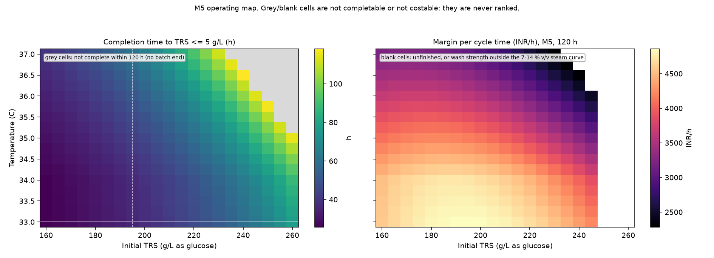
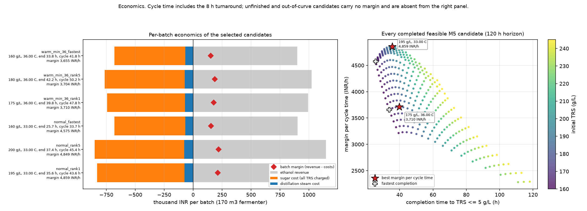
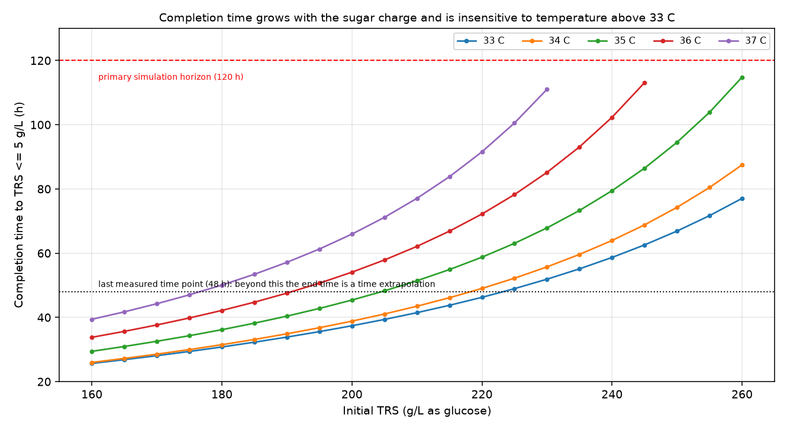
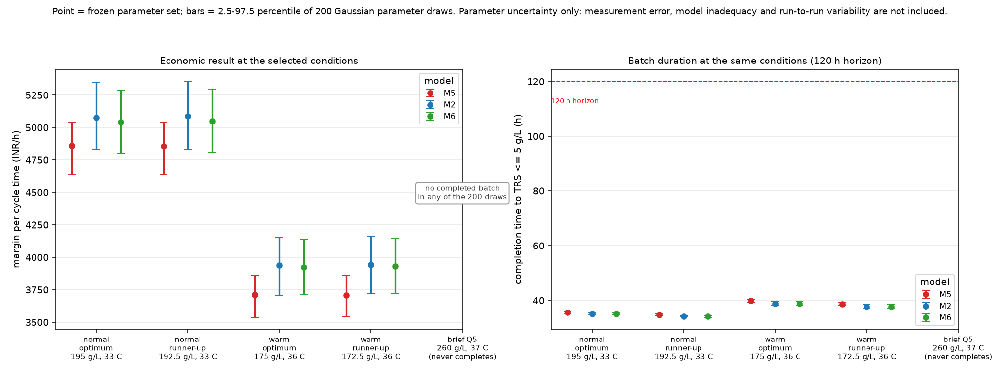

# Level 3 - Optimisation of initial sugar concentration and fermentation temperature

*Generated by `src/make_level3_report.py` from the Level 3 tables on 2026-10-28 19:52:20. Do not edit by hand: regenerate with `python src/make_level3_report.py`.*

## 1. Executive summary

The plant must pick an initial sugar charge and a fermentation temperature for October, when the
fermenters can be held at 33 C but not colder, and it wants the largest daily margin per fermenter.
The answer below comes from the frozen Level 2 model M5 (selection rule D-24, held-out run R6 never
used for fitting or tuning), evaluated over a documented search grid with an explicit
batch-completion rule and the assignment's own cost data.

**Recommended operating condition (normal 33-37 C constraint): 195.0 g/L TRS at 33.0 C.** Under the frozen M5
parameters this batch reaches residual TRS of 5 g/L in 35.57 h, produces 86.32 g/L ethanol, needs a
wash of 10.94 % v/v, and returns **4,858.69 INR/h of margin per cycle time**
(116,608.5 INR/day as a derived 24 h equivalent) for a 170 m3 fermenter. That is the highest
margin-per-cycle-time point of every completed, costable candidate in the search.

**If the cooling water warms by 3 C and 36 C becomes the floor: 175.0 g/L TRS at 36.0 C**, completing in
39.82 h with 3,710.13 INR/h (89,043.0 INR/day). Restricting the minimum temperature to 36 C reduces the
margin by 1,148.56 INR/h, 23.6 % of the normal-scenario value: at 36 C the same sugar
charge takes longer to reach 5 g/L, so the fixed 8 h turnaround is amortised over a longer cycle.

Three results matter as much as the numbers themselves:

* The optimum is **not** at the highest sugar charge. Every charge at or above roughly 250 g/L either
  fails to finish or lands above 14 % v/v wash, where the assignment's steam curve stops. Those
  candidates cannot be costed and are never ranked, so the recommendation sits just under 200 g/L.
* 443 candidates are completed and feasible, 31 are completed but outside the
  steam curve, and 27 never reach 5 g/L within the 120 h horizon. The last two groups carry no
  margin at all in the tables, and the search keeps them in separate status classes.
* The 37 C / 260 g/L prediction the brief asks for does **not** complete within 120 h. It reaches
  105.37 g/L ethanol and about 30.3 g/L of residual sugar, and it is
  reported as a low-trust extrapolation, not as an operating point.

Uncertainty is quoted, not hidden: parameter-ensemble intervals on the margin are
4,641.97 to 5,038.55 INR/h (normal optimum) and 3,538.06 to 3,858.37 INR/h (36 C scenario); every draw completes and stays inside
the steam curve, so the *ranking* is stable even though the *value* is not precise. See section 10.

## 2. Engineering problem and optimisation objective

Eight lab batches of molasses fermentation were supplied with biomass, TRS, ethanol and cumulative
CO2 measured for 48 h. Levels 1 and 2 produced a kinetic model and a frozen choice of model structure.
Level 3 is a different question: given that frozen model, which (initial sugar, temperature) pair
should the plant run to maximise profit per fermenter?

The objective is the assignment's own metric (brief section 4):

```
daily margin per fermenter = (ethanol value - sugar cost - distillation steam cost) / cycle time
cycle time                 = batch time + 8 h turnaround
```

subject to the batch-completion constraint (residual TRS <= 5 g/L) and the operating bounds
160-260 g/L TRS and 33-37 C (36-37 C in the warm scenario). The decision variables are the sugar charge
S0 and the temperature T; everything else (inoculum 2.5 g/L, working volume 170 m3, turnaround 8 h)
is fixed by the plant data or the brief.

This is not a model-selection problem and not a convergence problem. M5 was chosen before Level 3 by
D-24 and is used unchanged; the Level 3 task is to search its feasible space honestly and to say where
the confidence stops.

## 3. Inputs and data-quality limitations

Every input used by Level 3 is listed in `outputs/tables/optimization_input_audit.csv` with its role,
units, validation and status. Summary: 18 inputs, of which
16 are verified against a checksum or a frozen hash,
1 is only partially verified (the assignment brief, see below) and
2 are verified but carry an explicitly recorded unresolved
limitation (steam-curve provenance, plant inoculum practice, temperature interpolation).
The raw CSV checksums were recomputed during the audit and passed.

| id | path | role | units | type | original / derived / assumed | validation | status |
|---|---|---|---|---|---|---|---|
| IN-01 | `data/raw/runs.csv` | Run-level design and initial conditions (T, S0, X0) | temperature_C; initial_TRS_g_L_as_glucose; inoculum_biomass_g_L | CSV, 8 rows x 6 columns | original | SHA-256 against data/raw/CHECKSUMS.sha256; 8 runs R1-R8; X0 identical (2.5 g/L) in all runs | verified |
| IN-02 | `data/raw/timecourse.csv` | Measured time courses (biomass, TRS, ethanol, CO2) | time_h; g/L throughout | CSV, 8 runs x 14 time points x 4 variables | original | SHA-256 against CHECKSUMS.sha256; time grid 0-48 h per brief; no missing values | verified |
| IN-03 | `data/raw/endpoint_hplc.csv` | 48 h by-products and pH (carbon balance, run screening) | glycerol_g_L; lactic_acid_g_L; final_pH | CSV, 8 rows x 4 columns | original | SHA-256 against CHECKSUMS.sha256; 'n.d.' parsed as below-detection (<0.2 g/L) in carbon_balance.py | verified |
| IN-04 | `data/raw/CHECKSUMS.sha256` | Raw-data integrity manifest | - | text, sha256 of the three raw CSVs | original | Recomputed for all three files during the Level 3 validation chain | verified |
| IN-05 | `docs/assignment_brief.md` | Governing specification: plant data, economics, steam curve, questions | mixed (m3, INR, h, g/L, % v/v) | Markdown extracted from the assignment PDF | derived (PDF text extraction) | Steam curve, economics constants and completion criterion checked against src/plant_uncertainty.py; PDF-extracted tables read in row order | partially verified - the original assignment PDF is not available, so PDF-only wording cannot be confirmed |
| IN-06 | `outputs/tables/level1_frozen.json` | Frozen Level 1 parameters, training set and held-out run | mixed | JSON | derived (Level 1 fit) | parameters_csv_sha256 recomputed and matched; holdout = R6; training = R1,R2,R3,R4,R5,R8 (no R6) | verified |
| IN-07 | `outputs/tables/model_selection_frozen.json` | Frozen Level 2 model selection (D-24) | - | JSON | derived (Level 2 selection) | preferred = M5; rule = D-24; r6_used_for_selection = false; model_comparison.csv and candidate_parameters.csv SHA-256 both matched | verified |
| IN-08 | `outputs/tables/work/fit_M5.json` | Primary parameter set for every Level 3 scenario | mixed (1/h, g/L, g/g, -, 1/C) | JSON (theta, covariance, diagnostics) | derived (Level 2 fit M5) | theta reproduced by candidate_parameters.csv to 1e-12; status 3; 0 solver failures; 0 parameters at a bound; 8/8 multistarts near-best | verified |
| IN-09 | `outputs/tables/work/fit_M2.json; outputs/tables/work/fit_M6.json` | Robust alternative models for the model-structure comparison | mixed | JSON | derived (Level 2 fits) | Loaded through the same loader as M5; convergence diagnostics recorded in the policy record | verified (used for comparison only, never substituted for M5) |
| IN-10 | `outputs/audits/task2/sensitivity/level2/floor_0/outputs/tables/work/fit_M5.json; outputs/audits/task2/sensitivity/level2/floor_0p5/outputs/tables/work/fit_M5.json` | Discrete CO2-floor alternatives (Task 2 evidence) used as an assumption-sensitivity check | mixed | JSON | derived (Task 2 sensitivity refits) | Read-only reuse; both Task 2 cases re-selected M5 with explicit convergence | verified as Task 2 evidence; not refitted during Level 3 |
| IN-11 | `outputs/tables/plant_prediction_uncertainty.csv; outputs/tables/structure_spread.csv` | Existing Level 2 parameter-ensemble and structure-spread evidence (context, not recomputed) | mixed | CSV | derived (Level 2) | Used only as prior context; Level 3 uncertainty is recalculated at the Level 3 optima | verified as Level 2 evidence |
| IN-12 | `docs/requirements_traceability.csv` | Requirement-to-evidence matrix carried forward from earlier phases | - | CSV | derived | Extended with the Level 3 requirements in this phase | verified |
| IN-13 | `outputs/tables/carbon_balance_all_runs.csv` | Carbon balance for all eight runs (Level 2 evidence) | C-mol/L, % | CSV | derived (Level 2) | Eight run rows present; recovery_pct recomputed by the test suite | verified |
| IN-14 | `outputs/tables/model_comparison.csv` | QAICc comparison underlying the frozen selection | - | CSV | derived (Level 2) | SHA-256 matched the frozen record | verified |
| IN-15 | `(assumption) steam design curve 7-14 % v/v` | Distillation steam cost per litre of ethanol | % v/v -> kg/L | 8 tabulated points from the brief | assumed (supplied design curve, but its provenance/limits are not documented in the available brief) | Table transcribed into src/level3.py and cross-checked against src/plant_uncertainty.py; no interpolation outside 7-14 % v/v | verified transcription; curve validity limits unresolved without the PDF |
| IN-16 | `(assumption) constant broth volume, ethanol not stripped` | Mass basis for all economics | - | brief assumption | assumed | Stated in brief section 3; used unchanged | verified (brief-stated assumption) |
| IN-17 | `(assumption) X0 = 2.5 g/L for all plant scenarios` | Initial biomass for every simulated batch | g/L | scalar | assumed (equal to the lab inoculum) | All eight runs used 2.5 g/L in runs.csv, so plant scenarios are simulated at the measured inoculum | verified as the lab value; plant inoculum practice unverified |
| IN-18 | `(assumption) temperature multipliers between 30/34/37 C` | kT(T) used at 33-37 C | - | piecewise-linear interpolation of fitted k34, k37 | assumed | Interpolation only inside the observed 30-37 C range; no extrapolation; 37 C informed by one run (R8) | assumption recorded; unverified between measured temperatures |

What can and cannot be verified:

* **Verified.** The three raw CSVs (SHA-256 against `data/raw/CHECKSUMS.sha256`), the frozen Level 1
  parameter file, the frozen Level 2 selection and the M5 parameter vector. All hashes match and M5
  reproduces from `outputs/tables/candidate_parameters.csv` to 1e-12.
* **Partially verified.** `docs/assignment_brief.md` is an extracted text version of the assignment.
  The economics constants, the completion rule and the steam curve were cross-checked against
  `src/plant_uncertainty.py` and are used consistently, but the original PDF is not available. Any
  PDF-only requirement, and the exact provenance of the steam curve beyond its eight tabulated
  points, cannot be confirmed. This is recorded as an unresolved requirement, not papered over.
* **Assumed.** Constant broth volume with no ethanol stripping (brief section 3), 2.5 g/L inoculum for
  every plant scenario (the value all eight lab runs used), and piecewise-linear temperature
  multipliers between the measured 30/34/37 C levels.

Data-quality limits that propagate into Level 3: the data stop at 48 h while completions take
25-120 h; only one run (R8) was made at 37 C; and the CO2 measurement has a modelling floor of
0.10 g/L that enters the weighting and therefore the parameter covariance.

## 4. Kinetic model description and equations

Level 3 does not re-implement the kinetics. It integrates the frozen Level 2 structure through
`models.simulate`, so the model used here is provably the model that was selected (the loader checks
the parameter names, the frozen hashes and the selection record before any search runs).

States X (biomass), S (TRS as glucose), P (ethanol), C (cumulative CO2), all g/L, constant volume,
time in h:

```
mon   = S / (K_s + S)                                  K_s = 1.0 g/L (fixed, Level 1 decision)
kT    = rate multiplier: 1 at 30 C, k34 at 34 C, k37 at 37 C, linear between, error outside 30-37 C
Pm(T) = P_max * exp(-beta_P * (T - 30))                M5: ethanol tolerance falls as T rises
inh   = max(1 - P/Pm(T), 0) ** n_inh                   M5: n_inh is estimated, not fixed
mu    = mu_max * kT * mon * max(1 - X/X_max, 0)        growth is not directly inhibited by ethanol in M5
q_S   = q_max * kT * mon * inh                         catabolic sugar uptake
dX/dt = mu*X
dS/dt = -1.2206*mu*X - q_S*X                           1.2206 g glucose per g biomass (C-mol stoichiometry)
dP/dt = Y_P*q_S*X
dC/dt = rho_CO2*dP/dt
```

Frozen M5 parameters used for every scenario in this report
(`outputs/tables/work/fit_M5.json`, parameter set `M5_a29043ff3379ad5d`):

| parameter | unit | value | meaning |
|---|---|---|---|
| mu_max | 1/h | 0.164413 | maximum specific growth rate at 30 C |
| X_max | g/L | 11.1076 | biomass carrying capacity |
| q_max | g/g/h | 1.41705 | maximum specific sugar uptake at 30 C |
| P_max | g/L | 194.967 | ethanol inhibition constant at 30 C |
| Y_P | g/g | 0.480625 | ethanol yield on catabolised sugar |
| rho_CO2 | g/g | 0.978339 | CO2 released per unit ethanol formed |
| k34 | - | 1.08651 | rate multiplier at 34 C |
| k37 | - | 0.80493 | rate multiplier at 37 C |
| beta_P | 1/C | 0.0488456 | log-slope of P_max with temperature |
| n_inh | - | 2.42833 | ethanol-inhibition exponent |

For M5 the fit gives a high P_max (195.0 g/L) together with an exponent n_inh above 1. Those two
parameters trade off against each other: the data determine the *shape* of the inhibition curve near
the measured ethanol levels but not the two coefficients separately. That correlation is carried into
the uncertainty analysis in section 10 and is the reason the intervals there are wider than the
residual scatter would suggest.

## 5. Model-selection policy and why M5 is retained

The frozen decision is unchanged and was verified programmatically before any Level 3 calculation
(`outputs/audits/level3/model_policy.json`):

| check | result |
|---|---|
| frozen preferred model | M5 |
| selection rule | D-24 |
| R6 used for selection | False |
| held-out run | R6 (never in the training set) |
| training runs | R1, R2, R3, R4, R5, R8 |
| model_comparison.csv SHA-256 | matches the frozen record |
| candidate_parameters.csv SHA-256 | matches the frozen record |
| fit_M5 solver status / failures / parameters at a bound | converged, 0 failures, none at a bound |
| all Level 3 policy checks | PASSED |

M5 improved QAICc from 454.4 (M2) to 309.8, with reduced
chi-square 3.86 (the residual variance ratio c-hat is 3.86), and every one of its
multistarts converged to the same minimum. That evidence was fixed in Level 2 and is not revisited
here to suit a profitability outcome. The alternatives M2 and M6 are **comparison models only**: they
are evaluated on the same grid and reported in section 10, but they never replace M5 in the
recommendation.

## 6. Numerical method and search procedure

Simulation. Each scenario integrates the ODEs from t = 0 to 120 h on a 0.25 h grid with
`scipy.integrate.solve_ivp` (LSODA, rtol 1e-9, atol 1e-11), starting from X0 = 2.5 g/L, S0 as searched,
P = C = 0. A solver failure would be recorded as `simulation_failed` and excluded; none occurred.

Search. A three-stage deterministic search, not a local optimiser, so the whole surface is visible:

| stage | initial TRS (g/L) | temperature (C) | purpose |
|---|---|---|---|
| coarse | 160, 180, 200, 220, 240, 260 | 33, 34, 35, 36, 37 | locate the promising region |
| dense | 160 to 260 in 5 g/L steps | 33 to 37 in 0.25 C steps | map both scenarios |
| refinement | +/- 2.5 and 5 g/L around the 8 best of each scenario | +/- 0.125 and 0.25 C | check the optimum is not a grid artefact |

1,572 scenario rows were evaluated in total (M5 on both horizons plus M2 and M6 on the primary horizon). The
refinement moved the normal-scenario optimum by at most 2.5 g/L (the dense 195 g/L point remains best)
and left the 36 C optimum at 175 g/L, so the reported optima are not edge artefacts of the coarse grid.
A local optimiser would not have added information here: the objective is smooth in S0 but flat within
about 10 INR/h over 187.5-200 g/L, and the binding constraint is feasibility, not a gradient condition.

Ranking uses the 120 h primary horizon only. The 240 h run in section 12 is a diagnostic.

## 7. Batch-completion criterion and feasibility definitions

A batch is complete only when residual TRS is at or below 5 g/L. Completion time is the first downward
crossing of 5 g/L, linearly interpolated between the two bracketing time points; the reported final TRS
of a completed batch is therefore exactly 5.000 g/L by construction.

Each candidate is placed in exactly one status class:

| status | meaning | economics |
|---|---|---|
| `completed_feasible` | reached TRS <= 5 g/L inside the horizon and the wash is inside the 7-14 % v/v steam curve | priced |
| `completed_outside_steam_curve` | reached the threshold, but the wash strength is outside the supplied curve | **not priced**, no margin assigned |
| `unfinished` | did not reach 5 g/L within the horizon | **no completion time, no margin** |
| `simulation_failed` | the ODE integration failed | no quantities |

This is the rule that keeps the answer honest: an unfinished batch is never given a margin at a
stopping time, and a batch the steam curve does not cover is never given a margin either. For M5 on
the primary horizon the counts are 443 completed feasible rows, 31 completed rows outside the 7-14 % v/v steam curve and 27 unfinished rows.

## 8. Plant economics: equations, assumptions and units

Per completed feasible batch, per 170 m3 fermenter:

```
sugar charged      m_S  = S0 [g/L] * 170 [m3]                     = kg      (1 g/L = 1 kg/m3)
sugar cost         Cs   = m_S * 25 INR/kg
ethanol mass       m_E  = P_end [g/L] * 170 [m3]                  = kg
ethanol volume     V_E  = m_E / 0.789 kg/L                        = L
revenue            R    = V_E * 60 INR/L
wash strength      w    = P_end / 7.89                            = % v/v
steam intensity    s    = curve(w)                                = kg steam per L ethanol
steam cost         Cst  = s * V_E * 1.6 INR/kg                    (1600 INR/t)
batch margin       M    = R - Cs - Cst                            = INR
cycle time         t_c  = t_end + 8 h
margin per cycle   M/t_c                                          = INR/h
24 h equivalent    24 * M/t_c                                     = INR/day  (derived)
```

Assumptions, stated so they can be challenged: the broth volume is constant and equals the working
volume; ethanol carried off with CO2 is condensed and returned (brief section 3); the plant pays for
**all** sugar charged, including what is left unfermented, so the sugar cost uses S0 and not the
consumed sugar; the steam curve is interpolated linearly between its eight tabulated points and is
never extrapolated; the 24 h equivalent is a textbook conversion of the assignment's INR/h figure and
is labelled as derived wherever it appears.

Dimensional check (also asserted in `tests/test_level3.py`): concentration in g/L multiplied by volume
in m3 gives mass directly in kg, so no 1000-factor appears anywhere. Example for the recommended batch:

| case | TRS (g/L) | T (C) | sugar (t) | sugar cost (kINR) | ethanol (L) | revenue (kINR) | steam (t) | steam cost (kINR) | margin (kINR) | margin/cycle (INR/h) |
|---|---|---|---|---|---|---|---|---|---|---|
| normal_33_37_M5_rank1 | 195 | 33.00 | 33.15 | 828.8 | 18,599 | 1,115.9 | 47.18 | 75.5 | 211.7 | 4,858.69 |
| warm_min_36_M5_rank1 | 175 | 36.00 | 29.75 | 743.8 | 16,532 | 991.9 | 44.24 | 70.8 | 177.4 | 3,710.13 |
| normal_33_37_M5_fastest | 160 | 33.00 | 27.20 | 680.0 | 15,021 | 901.3 | 42.03 | 67.2 | 154.0 | 4,574.79 |

## 9. Optimisation results

### 9.1 Normal scenario (33-37 C)



*Figure 1. Left: completion time to TRS <= 5 g/L; grey cells are not complete within 120 h. Right:
margin per cycle time; blank cells are unfinished or have a wash outside the 7-14 % v/v steam curve.
Neither can be ranked, which is why the profitable region ends near 250 g/L even though the model
keeps producing ethanol beyond it.*

| # | TRS (g/L) | T (C) | complete (h) | TRS end (g/L) | ethanol (g/L) | wash (% v/v) | steam (kg/L) | margin (INR/batch) | cycle (h) | margin/cycle (INR/h) | 24 h equiv. (INR/day) |
|---|---|---|---|---|---|---|---|---|---|---|---|
| 1 | 195 | 33.00 | 35.571 | 5.000 | 86.320 | 10.940 | 2.5365 | 211,696 | 43.571 | 4,858.69 | 116,608.5 |
| 2 | 192.5 | 33.00 | 34.705 | 5.000 | 85.127 | 10.789 | 2.5532 | 207,447 | 42.705 | 4,857.66 | 116,583.8 |
| 3 | 197.5 | 33.00 | 36.467 | 5.000 | 87.515 | 11.092 | 2.5217 | 215,914 | 44.467 | 4,855.64 | 116,535.4 |
| 4 | 190 | 33.00 | 33.870 | 5.000 | 83.934 | 10.638 | 2.5698 | 203,223 | 41.870 | 4,853.70 | 116,488.8 |
| 5 | 200 | 33.00 | 37.396 | 5.000 | 88.710 | 11.243 | 2.5081 | 220,118 | 45.396 | 4,848.82 | 116,371.7 |

The top of the surface is remarkably flat: the first five candidates sit within 10 INR/h of each other
while their completion times differ by 3.7 h. That flatness is not a numerical accident. Raising the
sugar charge adds ethanol revenue per batch but adds sugar cost (the plant pays for everything charged)
and lengthens the cycle, and the two effects very nearly cancel between about 187 and 200 g/L. The
practical consequence is that the plant can choose anywhere in that window for robustness without
losing meaningful money, which is a better answer than a single over-precise set point.



*Figure 2. Left: revenue, sugar cost, steam cost and resulting batch margin for the selected
candidates. Right: every completed feasible candidate; higher sugar charges buy more ethanol but need
longer cycles, so the margin per cycle time has a clear maximum well before the sugar limit.*



*Figure 3. Completion time grows with the sugar charge. Temperature above 33 C makes the batch slower,
not faster, because in M5 the ethanol-tolerance term falls with temperature and the fitted k37 is below
k34. Points above 48 h are beyond the last measurement, and the dotted line marks that limit.*

Why the optimum is at 33 C rather than at a warmer temperature. The fitted rate multiplier alone would
favour warmth near 34 C (k34 = 1.0865 > 1), but M5 also makes ethanol
tolerance fall with temperature: beta_P = 0.0488 per C, so
P_max(T) drops from 195.0 g/L at 30 C to 168.4 g/L at 33 C, 145.4 g/L at 36 C and
138.5 g/L at 37 C. At a fixed 195 g/L charge the simulated completion times are
35.57 h at 33 C, 36.79 h at 34 C, 50.66 h at 36 C and 61.29 h at 37 C, while the final
ethanol barely moves (86.32 to 86.28 g/L): the warmer batch finishes with essentially the same
ethanol but needs far longer, because the inhibition factor throttles sugar uptake earlier. That is why
the margin per cycle time falls steeply with temperature and the optimum sits at the coldest allowed
temperature. The behaviour is a property of the frozen fit - the 34 C and 37 C lab runs stalled earlier
than the 30 C runs - not an assumption inserted for convenience.

### 9.2 Warm scenario (cooling water +3 C, minimum 36 C)

| # | TRS (g/L) | T (C) | complete (h) | TRS end (g/L) | ethanol (g/L) | wash (% v/v) | steam (kg/L) | margin (INR/batch) | cycle (h) | margin/cycle (INR/h) | 24 h equiv. (INR/day) |
|---|---|---|---|---|---|---|---|---|---|---|---|
| 1 | 175 | 36.00 | 39.817 | 5.000 | 76.729 | 9.725 | 2.6758 | 177,405 | 47.817 | 3,710.13 | 89,043.0 |
| 2 | 172.5 | 36.00 | 38.711 | 5.000 | 75.540 | 9.574 | 2.6954 | 173,242 | 46.711 | 3,708.81 | 89,011.5 |
| 3 | 177.5 | 36.00 | 40.969 | 5.000 | 77.920 | 9.876 | 2.6562 | 181,602 | 48.969 | 3,708.50 | 89,004.0 |
| 4 | 170 | 36.00 | 37.650 | 5.000 | 74.352 | 9.424 | 2.7149 | 169,112 | 45.650 | 3,704.52 | 88,908.5 |
| 5 | 180 | 36.00 | 42.172 | 5.000 | 79.112 | 10.027 | 2.6371 | 185,815 | 50.172 | 3,703.52 | 88,884.6 |

The 36 C floor moves the optimum down to about 175 g/L and drops the margin per hour to
3,710.13 INR/h. The economic penalty of warming is 1,148.56 INR/h (23.6 %). What drives it is the
mechanism described in section 9.1: at 36 C the fitted ethanol tolerance is only 145.4 g/L against
168.4 g/L at 33 C, so sugar uptake throttles earlier and the batch needs a longer cycle to reach
5 g/L. The warm optimum is not the normal optimum shifted in temperature - at 36 C a lower charge (about
175 g/L) is better, because the batch must finish before inhibition makes the cycle uneconomic. The plant
should treat the warm case as a genuine loss of capacity, not as an inconvenience.

### 9.3 Fastest completion versus best margin

The fastest completed batch is 160 g/L at 33.0 C,
finishing in 25.67 h, but it returns only 4,574.79 INR/h. Running
the fermenter harder and finishing faster is not the same as earning more per hour; the metric rewards
the product of yield and time only after both sugar cost and turnaround are accounted for.

## 10. Model comparison and uncertainty analysis

### 10.1 Structure comparison (M5 against M2 and M6)

| scenario | model | case | TRS (g/L) | T (C) | complete (h) | ethanol (g/L) | margin/cycle (INR/h) | difference vs M5 (INR/h) |
|---|---|---|---|---|---|---|---|---|
| normal_33_37 | M2 | at_M5_optimum | 195 | 33.00 | 35.040 | 86.873 | 5,078.40 | +219.72 |
| normal_33_37 | M5 | at_M5_optimum | 195 | 33.00 | 35.571 | 86.320 | 4,858.69 | +0.00 |
| normal_33_37 | M6 | at_M5_optimum | 195 | 33.00 | 34.977 | 86.720 | 5,041.66 | +182.97 |
| normal_33_37 | M2 | own_optimum | 190 | 33.00 | 33.269 | 84.483 | 5,089.89 | +231.20 |
| normal_33_37 | M5 | own_optimum | 195 | 33.00 | 35.571 | 86.320 | 4,858.69 | +0.00 |
| normal_33_37 | M6 | own_optimum | 190 | 33.00 | 33.229 | 84.349 | 5,054.32 | +195.63 |
| warm_min_36 | M2 | at_M5_optimum | 175 | 36.00 | 38.848 | 77.297 | 3,937.66 | +227.54 |
| warm_min_36 | M5 | at_M5_optimum | 175 | 36.00 | 39.817 | 76.729 | 3,710.13 | +0.00 |
| warm_min_36 | M6 | at_M5_optimum | 175 | 36.00 | 38.858 | 77.249 | 3,924.04 | +213.92 |
| warm_min_36 | M2 | own_optimum | 170 | 36.00 | 36.646 | 74.913 | 3,943.95 | +233.82 |
| warm_min_36 | M5 | own_optimum | 175 | 36.00 | 39.817 | 76.729 | 3,710.13 | +0.00 |
| warm_min_36 | M6 | own_optimum | 170 | 36.00 | 36.704 | 74.887 | 3,931.52 | +221.39 |

At the M5 optimum the alternatives agree closely: M2 gives
5,078.40 INR/h and M6 gives
5,041.66 INR/h, against
4,858.69 for M5. Their own optima shift by one grid step (190 g/L instead of
195 g/L in the normal scenario, 170 g/L instead of 175 g/L in the warm one) and are 4.0-4.8 % higher in
margin, which is the model-structure spread the recommendation has to live with. The shift is small
and consistent in direction; it does not change the engineering conclusion that the plant should run
just below 200 g/L at the coldest temperature it can hold, only the last few percent of the number.

### 10.2 Parameter uncertainty at the recommended conditions



*Figure 4. Point estimates from the frozen parameter set; bars are the 2.5-97.5 percentile range of 200
Gaussian draws from the linearised covariance, truncated at the parameter bounds. Left: margin per
cycle time. Right: completion time. The 37 C / 260 g/L brief point never completes in any draw.*

| candidate | source | completion (h) | margin/cycle point (INR/h) | 95% interval (INR/h) | draws completing |
|---|---|---|---|---|---|
| normal_33_37_M5_optimum | M5 | 35.27-35.90 | 4,858.69 | 4,641.97 to 5,038.55 | 1.00 |
| normal_33_37_M5_optimum | M2 | 34.74-35.45 | 5,078.40 | 4,828.65 to 5,345.28 | 1.00 |
| normal_33_37_M5_optimum | M6 | 34.70-35.41 | 5,041.66 | 4,801.96 to 5,287.66 | 1.00 |
| warm_min_36_M5_optimum | M5 | 39.32-40.41 | 3,710.13 | 3,538.06 to 3,858.37 | 1.00 |
| warm_min_36_M5_optimum | M2 | 38.23-39.56 | 3,937.66 | 3,708.32 to 4,156.29 | 1.00 |
| warm_min_36_M5_optimum | M6 | 38.31-39.58 | 3,924.04 | 3,710.52 to 4,138.73 | 1.00 |
| brief_q5_37C_260 | M5 | n/a | not completed | no completed batch | 0.00 |
| brief_q5_37C_260 | M2 | n/a | not completed | no completed batch | 0.00 |
| brief_q5_37C_260 | M6 | n/a | not completed | no completed batch | 0.00 |

Method and its limits. The draws use the covariance matrix stored with the fit and are truncated at
the fitted parameter bounds; all 200 draws were accepted, so no truncation bias is introduced. This is
**parameter uncertainty conditional on the M5 structure**. It does not include measurement error in the
raw data, model inadequacy, or run-to-run variability between batches, and the linearised covariance is
a local quadratic approximation around the least-squares minimum. The intervals below should therefore
be read as a lower bound on the real uncertainty, not as a prediction interval for a plant batch.

* Normal optimum: 4,641.97 to 5,038.55 INR/h; completion 35.27-35.90 h; every draw completes.
* Warm optimum: 3,538.06 to 3,858.37 INR/h; completion 39.32-40.41 h; every draw completes.
* Discrete assumption alternatives from the Task 2 CO2-floor refits move the normal-optimum margin only
  between 4,842.97 and 4,873.75 INR/h, i.e. far less than
  the parameter ensemble, so the CO2 floor is not what limits this decision.
* The 37 C / 260 g/L point completes in 0 % of draws.
  It is neither feasible nor priceable, in the point estimate or in any draw.

Because the *ranking* is preserved across models and across all draws, the recommendation is robust in
the sense that matters for a decision; the *amount* is uncertain by roughly -4.5 % / +3.7 %
around the normal optimum.

## 11. Figures and tables

| item | file | what it shows |
|---|---|---|
| Figure 1 | `outputs/figures/level3_feasible_region.png` | completion time and margin maps; infeasible cells blank |
| Figure 2 | `outputs/figures/level3_economics.png` | cost breakdown per batch and the margin/cycle-time surface |
| Figure 3 | `outputs/figures/level3_completion_time.png` | completion time against sugar charge at each temperature |
| Figure 4 | `outputs/figures/level3_uncertainty.png` | parameter-ensemble intervals at the selected conditions |
| Table 1 | `outputs/tables/optimization_grid.csv` | every evaluated scenario with model and parameter-set ids |
| Table 2 | `outputs/tables/optimization_recommendations.csv` | ranked recommendations per scenario and basis |
| Table 3 | `outputs/tables/plant_economics.csv` | full per-batch economics for the selected candidates |
| Table 4 | `outputs/tables/optimization_uncertainty.csv` | intervals and completion fractions per candidate and model |
| Table 5 | `outputs/tables/optimization_model_comparison.csv` | M5 vs M2 vs M6 at their own optima and at the M5 optimum |
| Table 6 | `outputs/tables/optimization_input_audit.csv` | input audit with verification status |
| Table 7 | `outputs/tables/optimization_horizon_sensitivity.csv` | what the unfinished cases do if the horizon is doubled |

Rounding: completion times to 3 decimals (h), concentrations to 3 decimals (g/L), margins per cycle to
2 decimals (INR/h), batch margins to the nearest INR, percentages to 1-2 decimals. Every figure is
computed from the unrounded values; the tables are the rounded renderings.

## 12. Sensitivity and validation checks

### 12.1 Horizon sensitivity (no hidden unfinished optimum)

27 M5 candidates do not reach 5 g/L within 120 h. They were re-run
to 240 h with the same frozen parameters: 26 of 27 complete within the extended horizon, and
0 of them would beat the best 120 h margin. The 240 h run is a
diagnostic only; it is not used to rank. The purpose is to show that the 120 h horizon is not hiding a
profitable candidate, which it is not.

| TRS (g/L) | T (C) | TRS at 120 h (g/L) | status at 240 h | completion at 240 h (h) | margin at 240 h (INR/h) | beats best 120 h margin |
|---|---|---|---|---|---|---|
| 260 | 35.25 | 6.32 | completed_outside_steam_curve | 123.90 | not priced | False |
| 255 | 35.50 | 5.06 | completed_outside_steam_curve | 120.17 | not priced | False |
| 260 | 35.50 | 9.63 | completed_outside_steam_curve | 134.23 | not priced | False |
| 255 | 35.75 | 8.29 | completed_outside_steam_curve | 129.95 | not priced | False |
| 260 | 35.75 | 13.01 | completed_outside_steam_curve | 146.05 | not priced | False |
| 250 | 36.00 | 6.95 | completed_outside_steam_curve | 125.84 | not priced | False |
| 255 | 36.00 | 11.63 | completed_outside_steam_curve | 141.11 | not priced | False |
| 260 | 36.00 | 16.44 | completed_outside_steam_curve | 159.67 | not priced | False |
| 245 | 36.25 | 5.64 | completed_feasible | 121.88 | 2,290.95 | False |
| 250 | 36.25 | 10.25 | completed_outside_steam_curve | 136.37 | not priced | False |
| 255 | 36.25 | 15.03 | completed_outside_steam_curve | 153.92 | not priced | False |
| 260 | 36.25 | 19.88 | completed_outside_steam_curve | 175.50 | not priced | False |
| 245 | 36.50 | 8.87 | completed_feasible | 131.85 | 2,127.71 | False |
| 250 | 36.50 | 13.61 | completed_outside_steam_curve | 148.43 | not priced | False |
| 255 | 36.50 | 18.45 | completed_outside_steam_curve | 168.73 | not priced | False |
| 260 | 36.50 | 23.33 | completed_outside_steam_curve | 194.04 | not priced | False |
| 240 | 36.75 | 7.50 | completed_feasible | 127.53 | 2,131.24 | False |
| 245 | 36.75 | 12.20 | completed_feasible | 143.20 | 1,967.92 | False |
| 250 | 36.75 | 17.01 | completed_outside_steam_curve | 162.31 | not priced | False |
| 255 | 36.75 | 21.89 | completed_outside_steam_curve | 186.00 | not priced | False |
| 260 | 36.75 | 26.79 | completed_outside_steam_curve | 216.00 | not priced | False |
| 235 | 37.00 | 6.15 | completed_feasible | 123.42 | 2,131.86 | False |
| 240 | 37.00 | 10.79 | completed_feasible | 138.24 | 1,975.09 | False |
| 245 | 37.00 | 15.58 | completed_feasible | 156.23 | 1,811.84 | False |
| 250 | 37.00 | 20.44 | completed_outside_steam_curve | 178.41 | not priced | False |
| 255 | 37.00 | 25.34 | completed_outside_steam_curve | 206.32 | not priced | False |
| 260 | 37.00 | 30.26 | unfinished | n/a | not priced | False |

### 12.2 Validation checks executed

* Frozen model policy re-verified before the search (section 5) and re-checked by the test suite.
* Completion criterion re-derived from the trajectory in `tests/test_level3.py`, including the
  first-crossing rule and the "already below threshold at t = 0" edge case.
* Economics re-derived from the saved table columns and compared to 1e-12 relative tolerance; unit
  identity asserted independently.
* Steam curve checked point by point against the brief, including the two out-of-range cases.
* No out-of-curve or unfinished row carries a margin; asserted over the whole grid.
* Raw CSV checksums recomputed; frozen hashes recomputed.
* All eight carbon balances are still present in the Level 2 table; 7 of 8 of them close within 95-105 %.
* Generated CSV/JSON verified ASCII with LF endings.

| run | C in (C-mol/L) | C out (C-mol/L) | recovery (%) | closes within 95-105% | in primary fit |
|---|---|---|---|---|---|
| R1 | 5.533 | 5.500 | 99.4 | yes | yes |
| R2 | 7.508 | 7.377 | 98.2 | yes | yes |
| R3 | 8.744 | 8.892 | 101.7 | yes | yes |
| R4 | 5.294 | 5.545 | 104.7 | no | yes |
| R5 | 7.362 | 7.372 | 100.1 | yes | yes |
| R6 | 8.827 | 8.863 | 100.4 | yes | held out |
| R7 | 7.458 | 7.533 | 101.0 | yes | excluded |
| R8 | 7.355 | 7.551 | 102.7 | yes | yes |

## 13. Engineering interpretation and trade-offs

1. **Sugar above about 200 g/L does not pay.** The plant pays for every kilogram of TRS it charges, so
   the extra sugar in a 260 g/L batch is a cost even when it is fermented. Its extra ethanol arrives
   late, which stretches the cycle and dilutes the fixed 8 h turnaround. The margin per cycle time peaks
   just under 200 g/L and then falls.
2. **The steam curve is a real constraint, not a formality.** Above 14 % v/v wash the supplied curve ends
   and the distillation cost cannot be estimated. Batches that produce more than about 110 g/L ethanol
   therefore fall outside the costed region: 31 completed rows outside the 7-14 % v/v steam curve, and none of them is priced. This is not a modelling
   limitation to be averaged away - it is the point at which the plant's own design data stops.
3. **Cold is valuable.** Under the fitted temperature response 33 C outperforms 34-37 C because ethanol
   tolerance falls with temperature: the same charge finishes far sooner when the broth is colder. Losing
   3 C of cooling capacity therefore costs 1,148.56 INR/h of margin (23.6 %).
4. **The recommendation is a plateau, not a peak.** Between 187.5 and 200 g/L the margin changes by less
   than 0.3 %. Operationally that means the set point can be chosen for other reasons (foaming, oxygen
   demand, downstream capacity) without sacrificing economics.
5. **Accuracy limits are time-related.** Completion happens at 25-48 h for the recommended conditions and
   the data stop at 48 h, so the recommended points sit at the edge of the measured window and slightly
   beyond it. Batches that need 60-120 h are a pure time extrapolation.

## 14. Answers to every supported Level 3 question

**Q1. Best feasible condition under the normal 33-37 C constraint.**
195.0 g/L TRS at 33.0 C: completion 35.571 h, residual TRS
5.000 g/L, ethanol 86.320 g/L, wash 10.941 % v/v,
batch margin 211,696.31 INR, cycle 43.571 h,
**4,858.69 INR/h** (116,608.5 INR/day derived).
Evidence: `outputs/tables/optimization_recommendations.csv` row `normal_33_37` rank 1.

**Q2. Best feasible condition with a 36 C minimum.**
175.0 g/L TRS at 36.0 C: completion 39.816 h, ethanol
76.729 g/L, **3,710.13 INR/h**
(89,043.0 INR/day), i.e. 1,148.56 INR/h less than the normal scenario
(23.6 %).

**Q3. Does the preferred condition change with M2 or M6?**
Not in substance. The best grid point moves by one step (190 g/L instead of 195 g/L in the normal scenario,
170 instead of 175 g/L in the warm one) and the alternatives give 4-5 % more margin at their own optima. M2's own normal optimum is
190 g/L at 33 C
(5,089.89 INR/h) and
M6's is 190 g/L at 33 C
(5,054.32 INR/h).
In the warm scenario both alternatives prefer 170 g/L. The engineering recommendation (coldest temperature
available, just under 200 g/L normal / about 175 g/L warm) is unchanged; M5 remains the reference because
D-24 selected it on held-out-safe evidence, not because it gives the best profit.

**Q4. Best estimated margin per cycle time.** 195.0 g/L at 33.0 C with
4,858.69 INR/h. This is the global maximum over every completed, costable
candidate in the search.

**Q5. Fastest to the TRS threshold.** 160 g/L at
33.0 C, 25.668 h. In the warm scenario the
fastest is 160 g/L at 36.0 C
(33.799 h). Fastest is not most profitable: the fast batch gives up
283.90 INR/h
relative to the optimum.

**Q6. Are the highest-margin candidates feasible under the completion rule?** Yes by construction - only
completed candidates are ranked. The interesting converse is that the candidates with the most ethanol
are not feasible: the ten highest-ethanol completed candidates all lie above 14 % v/v wash, so they are
recorded as completed-but-outside-the-steam-curve (31 completed rows outside the 7-14 % v/v steam curve in this search) and carry no margin. See
`outputs/tables/optimization_grid.csv`, column `feasibility_status`.

**Q7. What happens to the optimum when some candidates fail to reach 5 g/L?** They are excluded from the
ranking and reported separately: 27 unfinished rows, none of which would beat the recommended point even if the
horizon were doubled (26 of 27 complete by 240 h, 0 would outrank).
Because they carry no completion time and no margin, they cannot bias the optimum upward.

**Q8. Sensitivity of the recommendation to parameter and model uncertainty.**
Parameter uncertainty (200 draws, M5): margin 4,641.97 to 5,038.55 INR/h at the normal optimum and 3,538.06 to 3,858.37 INR/h at the
warm optimum, with 100 % of draws completing. Structure (M2/M6): the margin at the M5 optimum moves by
+219.72 INR/h (M2) and
+182.97 INR/h (M6). Discrete CO2-floor
alternatives: 4,842.97 to 4,873.75 INR/h. In every case the
preferred *condition* is stable and the *value* is not precise to more than a few percent.

**Q9. Which assumptions most affect the recommendation?** In order of impact: (i) the completion rule
itself, which removes every slow, high-sugar candidate; (ii) the steam curve's 14 % v/v upper end, which
removes every high-ethanol candidate; (iii) the fitted temperature multipliers, which decide that colder
is better and which rest on one 37 C run; (iv) the linear interpolation of the multipliers between
measured temperatures; (v) the CO2 floor, through the covariance and hence the interval width.

**Q10. Which additional experiment would most reduce decision uncertainty?** One extended batch at the
recommended condition (about 195 g/L TRS, 33 C) run past 48 h until residual TRS reaches 5 g/L, ideally
with one sample in the 60-96 h region. It tests the completion time that drives the metric and the 33 C
region the plant now operates in; a further 37 C run would help the warm scenario but cannot substitute
for it.

**Brief Q5 (37 C / 260 g/L prediction).** The model predicts
105.37 g/L ethanol and 30.26 g/L residual TRS at
120 h, with the batch still **not complete**. Trust is low: there is a single 37 C run (R8, 220 g/L), no
observation at 260 g/L at that temperature, the prediction runs 72 h beyond the measured window, and the
ethanol level exceeds the range where M5's inhibition parameters are individually identified. It is
reported because the brief asks for it, and it is not an operating recommendation.

**Brief Q6 (the one experiment that would most reduce the uncertainty that matters).** The same extended
batch as Q10. The existing Level 2 experimental-design analysis already ranked long-horizon observations at
the candidate operating conditions as the design that most reduces the propagated margin variance
(`outputs/tables/experiment_design.csv`); Level 3 makes that concrete by naming the condition.

## 15. Limitations and recommendations for additional experiments

* **Time extrapolation.** Completion times of 25-48 h are near the 48 h data limit; 60-120 h completions
  are extrapolation. The recommendation is inside the mild end of that range.
* **One 37 C run.** The warm scenario leans on R8 alone. The 36 C case is a temperature interpolation, not
  a measurement.
* **P_max / n_inh trade-off.** For M5 these two parameters are strongly associated; the interval on any
  ethanol-limited prediction is wider than the residual scatter implies.
* **Numerical environment sensitivity.** The R8 leave-one-run-out result and some refits are sensitive to
  the fitted minimum and to the numerical environment (documented in the Task 2 evidence). Level 3 does not
  refit, so it inherits the frozen values, but a re-fit elsewhere could shift them.
* **Residual autocorrelation and model inadequacy** reduce predictive confidence and are not represented
  in the parameter intervals.
* **CO2 floor of 0.10 g/L** is a modelling assumption; its two discrete alternatives were quantified and
  shown to matter far less than the parameter ensemble.
* **Steam curve provenance.** Only eight points are supplied; behaviour outside 7-14 % v/v is unknown and
  deliberately not extrapolated.
* **Original assignment PDF unavailable and Windows verification pending.** Both are recorded as
  unresolved rather than assumed.

Recommended next experiments, in priority order:
1. One batch at about 195 g/L TRS and 33 C, sampled to the 5 g/L endpoint (tests the completion time and the
   recommended operating region).
2. One repeat at 37 C with high sugar (250-260 g/L) to test the M5 inhibition extrapolation the brief asks about.
3. Two to three replicate batches at the recommended condition to measure run-to-run variability, which no
   current interval includes.

## 16. Reproduction instructions

```bash
# 1. environment (Linux sandbox used for the reported results)
python -m pip install -r requirements.txt

# 2. Level 3 workflow (input audit -> grid -> recommendations -> uncertainty -> comparison -> figures)
python src/level3_optimize.py --stage all --n-draws 200

# 3. regenerate this report and its claim set
python src/make_level3_report.py

# 4. consistency audit and tests
python src/level3_consistency_audit.py
python -m pytest -q

# 5. submission snapshot and archive
python scripts/build_submission.py
python scripts/verify_submission.py
python scripts/create_final_zip.py
```

Windows equivalent: `scripts\reproduce_level3.ps1`. The workflow is deterministic given the frozen
parameter files; the only random component is the uncertainty ensemble, which uses seed 20261028.

Code and data references:

| purpose | file |
|---|---|
| model policy, completion rule, economics, steam curve | `src/level3.py` |
| search, uncertainty, comparison, figures, answers | `src/level3_optimize.py` |
| this report | `src/make_level3_report.py` |
| report/claim/table consistency audit | `src/level3_consistency_audit.py` |
| Level 3 tests | `tests/test_level3.py` |
| frozen model structure used unchanged | `src/models.py`, `src/kinetics.py` |
| frozen parameters | `outputs/tables/work/fit_M5.json` |
| frozen selection record | `outputs/tables/model_selection_frozen.json` |
| raw data and checksums | `data/raw/runs.csv`, `data/raw/timecourse.csv`, `data/raw/endpoint_hplc.csv`, `data/raw/CHECKSUMS.sha256` |
| assignment brief | `docs/assignment_brief.md` |
| input audit | `outputs/tables/optimization_input_audit.csv`, `outputs/audits/level3/input_audit_summary.json` |
| model policy record | `outputs/audits/level3/model_policy.json` |
| answers record | `outputs/audits/level3/level3_answers.json` |

Environment used for the numbers in this report:

| item | value |
|---|---|
| platform | Linux-6.1.158+-x86_64-with-glibc2.36 |
| python | 3.11.2 |
| numpy | 2.4.6 |
| pandas | 3.1.0 |
| generation time | 2026-10-28 19:52:20 |

Verification status: Linux/sandbox execution only. Actual Windows execution of the test suite and the
reproduction scripts remains **pending** and must be performed locally; this report does not claim it.
